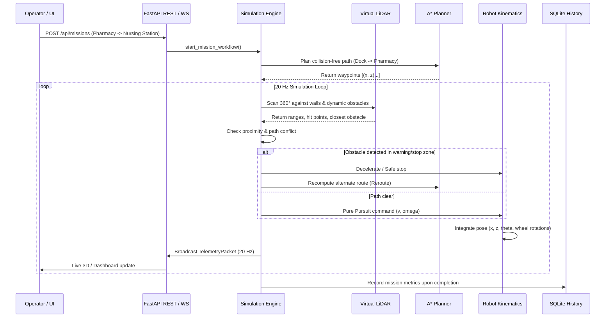

# MediBot KP Architecture Specification
**Company:** RoboNex Innovations  
**Product:** MediBot KP  
**Event:** AI Innovation Challenge 2026  
**System Type:** 3D Autonomous Hospital Delivery Robot Simulator & Digital Twin  

---

## 1. System Overview

MediBot KP is a professional 3D digital twin simulation and robotics control platform built for hospital intra-logistics. It demonstrates autonomous mobile robot (AMR) delivery workflows in a clinical healthcare environment, incorporating real-time A* global path planning, local reactive obstacle avoidance, virtual 360° planar LiDAR raycasting, simulated AI computer-vision perception, and WebSocket telemetry streaming at 20 Hz.

```mermaid
graph TD
    subgraph Frontend ["React 18 + Three.js / React Three Fiber"]
        UI["Dark Robotics Dashboard<br/>(Tailwind CSS)"]
        Scene3D["3D Hospital Digital Twin<br/>(Three.js Scene)"]
        Robot3D["MediBot KP 3D Mesh<br/>(Chassis, Wheels, Lid, LiDAR)"]
        Lidar3D["Virtual LiDAR Rays & Point Cloud"]
        Minimap2D["2D Occupancy Grid Minimap"]
        WSClient["WebSocket Telemetry Client (20 Hz)"]
        RESTClient["REST API Client"]
    end

    subgraph Backend ["Python 3.11 + FastAPI Engine"]
        Main["FastAPI Application & Lifespan"]
        Engine["SimulationEngine (20 Hz Tick Loop)"]
        AStar["A* Global Path Planner (8-Way + Smoothing)"]
        Costmap["OccupancyGrid & Inflation Layer (0.25m)"]
        MotionCtrl["Motion Controller (Pure Pursuit)"]
        LidarSim["Virtual 360° LiDAR Raycaster (180 Rays)"]
        PerceptionSim["Simulated Perception Module (FOV 120°)"]
        DiffDrive["Differential Drive Kinematics & Wheel Dynamics"]
        BatteryBMS["Simulated Battery BMS Model"]
        MissionSM["Mission State Machine"]
        DB[(SQLite Mission Audit Trail)]
    end

    UI -->|REST Commands| RESTClient -->|HTTP| Main
    UI -->|Quick Commands| WSClient
    Engine -->|WebSocket Packets| WSClient
    WSClient --> Scene3D
    WSClient --> Robot3D
    WSClient --> Lidar3D
    WSClient --> Minimap2D
    Engine --> AStar
    Engine --> Costmap
    Engine --> MotionCtrl
    Engine --> LidarSim
    Engine --> PerceptionSim
    Engine --> DiffDrive
    Engine --> BatteryBMS
    Engine --> MissionSM
    MissionSM --> DB
```



---

## 2. Data Flow Architecture

The data flow operates in a continuous, deterministic 20 Hz loop (`dt = 0.05s`):



---

## 3. WebSocket Telemetry Message Schema

Live telemetry packets are broadcast over `/ws/telemetry` at 20 Hz with the following JSON schema:

```json
{
  "timestamp": 1794938880.12,
  "seq": 1420,
  "product_name": "MediBot KP",
  "company": "RoboNex Innovations",
  "disclaimer": "MediBot KP is a virtual simulation prototype. Sensor readings, AI detections, navigation behavior, and performance metrics are simulated and do not represent physical-robot field testing.",
  "robot": {
    "pose": {
      "x": -4.20,
      "y": 0.0,
      "z": 0.15,
      "theta": 0.05,
      "theta_deg": 2.86
    },
    "velocity": {
      "linear": 0.45,
      "angular": -0.02
    },
    "wheels": {
      "left_rad": 42.15,
      "right_rad": 42.10
    },
    "battery": {
      "percentage": 91.2,
      "voltage": 25.42,
      "current_draw_a": 4.33,
      "is_charging": false,
      "wh_consumed": 3.84
    },
    "indicators": {
      "lidar_active": true,
      "camera_active": true,
      "headlights_on": true,
      "status_light": "amber",
      "safety_level": "CAUTION",
      "emergency_stop_triggered": false
    },
    "cargo": {
      "lid_open_ratio": 0.0,
      "has_package": true,
      "package_type": "Cold-Chain Biologics"
    }
  },
  "mission": {
    "phase": "NAVIGATING_TO_DESTINATION",
    "active_task": {
      "id": "TASK-311D4F",
      "pickup_dept_id": "pharmacy",
      "delivery_dept_id": "nursing_station",
      "package_type": "Cold-Chain Biologics",
      "priority": "STAT_CRITICAL",
      "status": "EN_ROUTE_DELIVERY",
      "distance_traveled_m": 14.8,
      "duration_seconds": 18.2,
      "reroutes_count": 0,
      "obstacles_encountered": 1
    },
    "target_name": "Nursing Station 3B",
    "distance_to_goal_m": 6.82,
    "estimated_eta_seconds": 11.4
  },
  "lidar": {
    "timestamp": 1794938880.12,
    "is_virtual": true,
    "disclaimer": "Virtual LiDAR - Raycast Simulation, Not Physical Sensor",
    "num_rays": 180,
    "max_range": 8.0,
    "min_range": 0.1,
    "ranges": [7.82, 7.80, "... 180 values ..."],
    "closest_distance_m": 1.83,
    "closest_angle_deg": 3.2,
    "closest_point": { "x": -2.37, "z": 0.25 },
    "alert_level": "CAUTION",
    "detected_dynamic_count": 8
  },
  "perception": [
    {
      "detection_id": "SIM-DET-obs_demo_human_1",
      "label": "Dr. Vance (Caregiver)",
      "category": "human",
      "confidence": 0.965,
      "distance_m": 1.83,
      "bearing_deg": 3.2,
      "world_x": -4.0,
      "world_z": 0.0,
      "bbox_2d": [0.2, 0.45, 0.8, 0.55],
      "is_simulated": true,
      "disclaimer": "Simulated Human/Obstacle Detection - Synthetic Perception Model, Not Physical Camera"
    }
  ],
  "obstacles": [
    {
      "id": "obs_demo_human_1",
      "type": "VIRTUAL_PERSONNEL",
      "name": "Dr. Vance (Caregiver)",
      "x": -4.0,
      "z": 0.0,
      "radius": 0.38,
      "confidence": 0.965,
      "is_active": true
    }
  ],
  "planned_path": [
    { "x": -4.20, "z": 0.15 },
    { "x": -1.50, "z": -1.79 },
    { "x": 1.0, "z": -3.5 }
  ],
  "metrics": {
    "total_distance_traveled_m": 14.8,
    "total_reroutes": 0,
    "time_stopped_for_obstacles_s": 0.0,
    "obstacles_avoided": 1
  },
  "alert_banner": {
    "type": "caution",
    "title": "PROXIMITY WARNING",
    "message": "Approaching Dr. Vance (Caregiver) (1.83m). Reducing speed for safety."
  }
}
```

---

## 4. Hospital Map & Navigation Graph Specification

The single-floor hospital layout spans $36.0\text{ m} \times 24.0\text{ m}$ (Coordinate bounds: $X \in [-18.0, 18.0]$, $Z \in [-12.0, 12.0]$):

| Department | ID | Category | Coordinate $(X, Z)$ | Waypoint Orientation $\theta$ | Doorway Access |
|---|---|---|---|---|---|
| Robot Charging Station | `dock` | Service | $(-13.0, -6.5)$ | $0.0\text{ rad}$ ($0^\circ$, East) | West Hallway |
| Central Pharmacy | `pharmacy` | Clinical | $(-12.5, 6.0)$ | $0.0\text{ rad}$ ($0^\circ$, East) | West Hallway |
| Nursing Station 3B | `nursing_station` | Clinical Hub | $(1.0, -3.5)$ | $-1.57\text{ rad}$ ($-90^\circ$, South) | Concourse Open Opening |
| Emergency Department | `emergency` | Critical | $(12.5, 6.0)$ | $3.14\text{ rad}$ ($180^\circ$, West) | East Hallway |
| Pathology & Clinical Lab | `laboratory` | Diagnostic | $(12.5, -6.0)$ | $3.14\text{ rad}$ ($180^\circ$, West) | East Hallway |
| Lobby & Reception | `reception` | Public | $(-2.0, 6.0)$ | $1.57\text{ rad}$ ($90^\circ$, North) | Center Open Foyer |
| Patient Room 101 | `room_101` | Inpatient | $(-6.0, 6.0)$ | $1.57\text{ rad}$ ($90^\circ$) | North Hallway |
| Patient Room 102 | `room_102` | Inpatient | $(6.0, 6.0)$ | $1.57\text{ rad}$ ($90^\circ$) | North Hallway |
| Patient Room 103 | `room_103` | Inpatient | $(-6.0, -6.0)$ | $-1.57\text{ rad}$ ($-90^\circ$) | South Hallway |
| Patient Room 104 | `room_104` | Inpatient | $(6.0, -6.0)$ | $-1.57\text{ rad}$ ($-90^\circ$) | South Hallway |

### Corridors:
- **Central Arterial Corridor:** Extends $X \in [-16.0, 16.0]$, $Z \in [-1.4, 1.4]$ ($2.8\text{ m}$ clear width).
- **West Hallway:** Connects Charging Dock and Pharmacy across Central Arterial Corridor at $X = -8.0\text{ m}$.
- **Center Concourse:** Connects Lobby and Nursing Station at $X = 0.0\text{ m}$.
- **East Hallway:** Connects Laboratory and Emergency Department at $X = 8.0\text{ m}$.
- **Occupancy Grid:** $144 \times 96$ cells at $0.25\text{ m}$ resolution with $0.50\text{ m}$ obstacle safety inflation.
