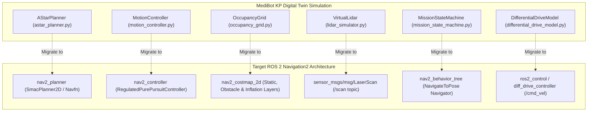

# MediBot KP — ROS 2 Navigation2 (Nav2) Migration Plan
**Architecture Bridge: From Python Digital Twin to ROS 2 Humble/Jazzy Deployment**  
**RoboNex Innovations**

---

## 1. Migration Architecture Overview

MediBot KP has been engineered from the ground up with modular interfaces that mirror the standard ROS 2 Navigation2 stack. The table below maps each component in the current Python/FastAPI simulation to its corresponding ROS 2 / Nav2 lifecycle node or plugin:



---

## 2. Component Mapping Details

### 2.1 Global Planning Layer
- **Current Simulation:** `backend/app/navigation/astar_planner.py` (8-connected A* with line-of-sight string pulling).
- **Target ROS 2 Node:** `nav2_planner::PlannerServer` using the `nav2_smac_planner::SmacPlanner2D` or `nav2_navfn_planner::NavfnPlanner` plugin.
- **Action Interface:** `nav2_msgs/action/ComputePathToPose`.

### 2.2 Local Trajectory Control
- **Current Simulation:** `backend/app/navigation/motion_controller.py` (Pure Pursuit with heading-error throttling and obstacle deceleration ramp).
- **Target ROS 2 Node:** `nav2_controller::ControllerServer` using `nav2_regulated_pure_pursuit_controller::RegulatedPurePursuitController`.
- **Command Topic:** Publishes `geometry_msgs/msg/Twist` to `/cmd_vel`.

### 2.3 Environmental Costmaps
- **Current Simulation:** `backend/app/navigation/occupancy_grid.py` (Global static grid + dynamic obstacle inflation).
- **Target ROS 2 Package:** `nav2_costmap_2d`.
  - **Global Costmap Layers:** `StaticLayer` (from `nav2_map_server`), `InflationLayer` (inflation radius 0.50m).
  - **Local Costmap Layers:** `ObstacleLayer` (subscribing to `/scan`), `InflationLayer`.

### 2.4 LiDAR Sensor Stream
- **Current Simulation:** `backend/app/perception/lidar_simulator.py` (180 rays, 360° FOV, 8m range).
- **Target ROS 2 Stream:** Physical planar LiDAR driver (e.g. SICK TiM or RPLiDAR C1) publishing `sensor_msgs/msg/LaserScan` with frame ID `laser_link`.

### 2.5 Mission Management & Behavior Trees
- **Current Simulation:** `backend/app/mission/mission_state_machine.py` (State machine managing Dock -> Pickup -> Load -> Transit -> Deliver -> Return).
- **Target ROS 2 Package:** `nav2_bt_navigator`.
  - XML Behavior Tree (`navigate_to_pose_w_replanning_and_recovery.xml`).
  - Action clients for cargo compartment lid (`medibot_msgs/action/OperateCargoDoor`).

---

## 3. ROS 2 Bridge Implementation Architecture

To run MediBot KP in a hybrid mode (where the React 3D Dashboard connects to a live ROS 2 cluster), we deploy `rosbridge_suite`:

```
[React 3D Dashboard] <--- WebSocket (JSON) ---> [rosbridge_server (port 9090)]
                                                         |
                                                 [ROS 2 DDS Bus]
                                       +-----------------+-----------------+
                                       |                 |                 |
                              [/cmd_vel]          [/scan]             [/odom]
                                       |                 |                 |
                         [diff_drive_controller]   [LiDAR Driver]   [Motor Encoders]
```

### Next Steps for Hardware Integration:
1. Package URDF/Xacro description of MediBot KP chassis and caster wheels.
2. Configure `ros2_control` hardware interface for brushless DC hub motors via CAN or Modbus.
3. Deploy Micro-ROS on Teensy 4.1 or STM32 for BMS monitoring, cargo lid servo actuation, and safety bumper limits.
4. Integrate SLAM Toolbox (`slam_toolbox`) for physical hospital mapping and localization (`nav2_amcl`).
